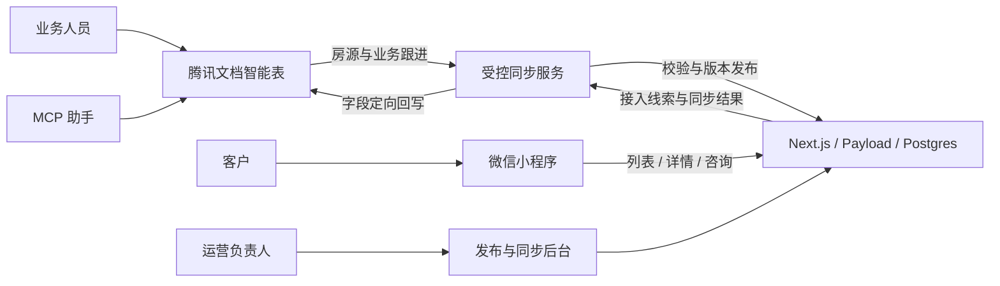

# 场景招租与腾讯文档协同架构建议

日期：2026-10-24。本文是产品与系统设计建议；“现状”来自仓库及腾讯文档只读检查，“建议”均未实现。未修改现有房源、共享权限、自动化或业务代码。

## 1. 建议采用的方向

产品聚焦学校、工业园区、写字楼等有明确服务人群的饭堂档口与商铺招租。围绕“找到合适经营空间—提交需求—顾问匹配—看铺—洽谈—确认结果”建立闭环。购物中心退出新增业务和主导航；社区、文旅不再作为首页主方向，历史资料保留并逐条处理。

推荐架构是：**腾讯文档智能表做日常业务工作台，现有 Next.js / Payload / Postgres 做发布、身份、业务校验与记录底座，小程序做公开展示与客户入口。**

业务人员直接协作填表，不必逐一登录 CMS；后台保留给运营负责人和技术管理员。MCP 用于自然语言整理、批量操作和辅助分析；持续运行的同步服务须另行验证授权及运行条件，不能把当前聊天连接当成已部署的服务。

以下默认第一阶段仍以招租撮合为主。若确实承接整食堂经营权、整体承包或招投标，应使用独立的合作方式与资格材料流程，不把它们都写成普通月租。

## 2. 已核查的项目现状

### 2.1 已有代码可以保留的部分

| 已有能力 | 证据 | 对新方向的价值 |
| --- | --- | --- |
| 首页、找铺、我的三个底部入口 | `mp/app.json` | 首期无需重做底部导航 |
| 项目和具体铺位同集合管理、铺位关联父项目 | `backend/collections/Projects.ts` | 可继续承载项目聚合页和具体房源 |
| 父项目状态约束子铺位公开 | `backend/lib/commercial.ts` | 新同步仍需遵守，避免下架项目的铺位继续展示 |
| 面积及基础月租数值、费用文字、经营及工程说明 | `Projects.ts` | 扩展结构化字段即可逐步过渡 |
| 微信登录、咨询按用户隔离、咨询可改删、附件归属检查 | `backend/app/api/leads/`、共享策略模块 | 客户入口应继续走后端 |
| 首次原文 `customerSnapshot` 与可编辑工作字段分离 | `backend/collections/Leads.ts` | 同步不能覆盖客户原文 |
| 公开房源禁止直接使用用户咨询附件 | `Projects.ts` | 文档导入也必须遵守图片审核规则 |
| 学校名称及文案脱敏 | `backend/lib/publicSchool.ts` | 新场景可扩展为场所名称、地址、图片的统一公开策略 |
| 上架检查、分享素材、小程序码 | 后台工作区 | 可改造成发布与推广工具 |

### 2.2 需要解决的差距

1. 首页场景仍是校园、社区、文旅、购物中心；没有工业园区、写字楼。
2. `projectType` 是校园细类，把食堂档口、商业街、临校铺位等混在一起；不能直接扩成通用空间分类。
3. `projects` 兼任项目和铺位，适合低成本起步，但不足以完整表达“园区—食堂/楼栋—房源”。
4. 咨询只有待联系、已联系、已结束和一条内部备注；当前没有客户分配、下次跟进、连续跟进日志或多房源匹配模型。
5. 当前城市选项只有广州，区域选项和筛选主要围绕广州；导入全省房源需要同步改前后台地区字典及校验。
6. 本地小程序默认走 Storage Mock；体验版/正式版 API 地址为空。只验证本地演示无法证明腾讯文档同步已经接入真实小程序。
7. 旧商业扩展报告围绕社区商业、文旅和购物中心，属于历史分析，本方案另起文档，不把旧结论当作此次转型前提。

### 2.3 现有腾讯文档的实际基础

已找到并只读检查：[学校商铺招商管理表](https://docs.qq.com/smartsheet/DTkZWd2ZHVGt6VGZJ)。文档 ID 为 `NFVwfGTkzTfI`，工作表 `tbIrk4` 名为“广东省学校商铺招商房源”。

- 共 25 个字段，读取时有 3 条记录；这些记录是否真实在营、是否测试资料尚未核实。
- 已有房源自动编号、全省城市、行政区、学校名称、位置、学生人数、业态、面积、商铺类型、招租状态。
- 已将租金及单位、进场费、押金、物业费和抽成分开，比现有后端的单一费用文字更适合作为新房源台账基础。
- 已有图片、资料链接、联系人/电话、负责人、最后核实日期。
- 有“全部房源、正在招租、按城市查看、按招租业态查看、待核实房源”5 个视图。返回的“正在招租”和“待核实房源”配置均没有筛选条件；不能仅凭视图名称认为它们已经筛选正确。
- 自动化列表为空；文件级权限为“部分成员可见”。本次未核查逐个成员或细粒度内容权限，不能据此推断业务人员只能看自己的记录。
- 现有记录的最后核实日期均明显早于本次检查日期，不能将修改日期或图片上传日期当成房源刚核实的证据。

建议在现表基础上渐进改造，先备份和建立字段映射，再调整字段；不重新抄写一份并长期维护两套。

## 3. 把业务分类拆成相互独立的维度

| 维度 | 建议选项 | 说明 |
| --- | --- | --- |
| 所处场景 | 学校 / 工业园区 / 写字楼 / 其他定向场所 | “其他”不必占首页；后续医院等用同一维度扩展 |
| 空间类型 | 食堂档口 / 独立商铺 / 配套服务点 / 整体食堂 | 整体食堂仅在实际开展时开放 |
| 业务方式 | 招租 / 转让；另记租赁或承包等合作属性 | 转让与普通出租的费用、授权和合同资料不同 |
| 计费方式 | 固定租金 / 营业额抽成 / 固定租金加抽成 / 保底与抽成取高 / 面议 | “加抽成”和“取高”必须明确区分 |
| 经营品类 | 快餐、粉面、小吃、茶饮、咖啡、便利店等 | 继续独立于场景和空间，不恢复大型商场品牌库 |

“食堂”不是与“学校、园区、写字楼”并列的场景：三个场景都可能有食堂。新空间类型不再依附校园字段。

关键场景资料建议如下：

| 场景 | 最需要客户看见的资料 |
| --- | --- |
| 学校 | 在校及住宿人数的来源与核实日期、学期/寒暑假营业安排、校内外位置、可经营品类、供餐时段、同类档口情况 |
| 工业园区 | 实际在岗人数或核实口径、班次、夜宵需求、工作日与周末供餐、员工补贴/结算、主要就餐时段 |
| 写字楼 | 实际办公人群或资料口径、工作日/周末情况、早餐午餐晚餐时段、外卖及楼宇出入条件、堂食/排烟/燃气条件 |

人数、就餐人数、客流和营业额分别记录；未知填“待核实”。不能用园区规划人数或楼宇建筑面积推导稳定营业额。只有核实的内容才参与“可明火”等筛选。

## 4. 系统结构与数据主责



图中的双向通路是不同字段各有方向，不是整行互相覆盖。

部署上先保留一个 Next/Payload 应用、一套 Postgres 和现有媒体存储，增加一个可独立运行的同步任务进程即可，无需先拆微服务。同步映射、任务、批准版本和审计由系统保存；场所及跟进镜像按实际页面需要进入 Payload 集合或专用表，避免把所有中间字段都变成业务人员要填写的后台表单。

| 数据 | 谁负责维护 | 后端职责 |
| --- | --- | --- |
| 房源业务资料、报价、负责人、核实日期 | 腾讯文档 | 校验、保存待发布版本和已发布快照 |
| 客户首次提交、微信归属、提交时间、授权和附件归属 | 后端 | 原始记录及访问控制；文档中展示必要的只读摘要 |
| 客户在小程序自行修改的需求 | 后端 | 保存修订，向文档更新“客户最新需求”，保留首次快照 |
| 内部负责人、跟进阶段、下次联系、跟进日志 | 腾讯文档 | 镜像业务结果及审计，不回传内部说明给客户 |
| 公开发布结果、资料错误、同步状态、公开链接 | 后端及同步服务 | 回写系统列，业务人员不手工维护 |
| 微信 OpenID、令牌、密钥、同步凭证 | 后端 | 不放入共享表格或小程序前端 |

这使“腾讯文档是主要管理模式”成立，同时保留稳定的线上服务和客户记录。后台不再要求业务人员重复录入房源。

## 5. 腾讯文档如何组织

### 5.1 先做四张工作表

第一期可在一个内部受控智能表文档内建 4 张工作表；若房源协作人员和客户数据接收者不同，应拆成权限不同的文档。视图隐藏列、筛选“我的客户”均不等于访问权限。

| 工作表 | 每一行是什么 | 核心字段 |
| --- | --- | --- |
| 场所/项目 | 一个学校校区、园区或写字楼项目 | 场所 ID、场景、内部名称、公开名称、城市/区县、地址公开级别、客群资料、核实日期、负责人 |
| 招商房源 | 一个可独立咨询和签约的招商单元 | 房源 ID、关联场所、食堂/楼栋、楼层/档口号、空间类型、面积、品类限制、费用结构、工程条件、档期、业务状态、发布申请 |
| 客户需求与跟进 | 一次具体需求或业务机会 | 需求 ID、来源咨询 ID、客户称呼/电话、客户最新需求、场景/类型/区域偏好、预算、负责人、内部阶段、下次跟进、结束原因 |
| 跟进日志 | 一次沟通、带看或洽谈动作 | 日志 ID、需求 ID、相关房源 ID、发生时间、经办人、方式、结果、下一步、客户可见摘要（可选，单独审核） |

首期“食堂/楼栋”先作为房源结构化位置字段，减少录入成本。当同一食堂有大量共用结算、营业和工程条件时，再独立为“经营区域”工作表。

同一个客户可提交多次需求，不以手机号强行合并咨询；去重只作提示。后续重复客户和品牌拓店增加后，再拆出独立客户档案。多房源推荐变得频繁时，增加第五张“需求—房源匹配”表，记录每个候选房源的推荐、看铺、拒绝原因，避免一个总阶段掩盖多个房源的进展。跨文档关联能力未经验证时，用系统 ID 在同步层连接。

### 5.2 对现有 25 个字段的改造

- 保留现有房源编号作为业务展示编号；另外保存稳定的系统 UUID 和腾讯 `record_id`，不能使用行号或房源名称做同步主键。
- “学校名称”逐步迁移为场所内部名称，学校特有资料仍保留在学校场景字段中；另设公开名称。
- “学生人数”扩成按场景填写的客群资料，记录来源与核实日期，不简单改名后把学生人数当园区在岗人数。
- 保留租金与租金单位，新增计费方式、抽成计算基数、保底关系、费用是否已核实、可公开报价。现有“抽成比例（%）”为普通数值字段，示例中的 5 表示 5%，导入时要约定单位，避免与百分数字段的小数存储混淆。
- “联系人/电话”拆为来源联系人、联系电话，默认内部；对客展示顾问联系方式。
- “招租状态”只说明库存业务情况，另设发布申请、发布结果和同步错误。
- 新增图片来源/实拍或示意、公开授权、最后同步时间、已发布版本、公开链接等列。已有图片真实性及公开使用资格需另行确认。
- 表格的“广州市/增城区”和当前代码的“广州/增城”需归一映射；不能把“松山湖”等区域名称直接认定为行政区代码，可另记园区片区。

### 5.3 业务人员的默认视图

| 视图 | 真实筛选或分组条件 |
| --- | --- |
| 我的房源 | 负责人为当前成员；仍需配套权限控制 |
| 招租中 | 库存状态为可租；洽谈中单独显示、是否继续接咨询可配置 |
| 待补资料 | 校验有错误或必填资料缺失 |
| 待发布 | 新版本已申请发布、尚未成功 |
| 待核实 | 无核实日期，或超过约定核实周期 |
| 我的待跟进 | 当前负责人、未结束且下次跟进到期 |
| 新咨询待分配 | 来源已接入、尚无负责人 |
| 客户阶段看板 | 按内部业务阶段分组 |
| 带看日历 | 按已确认的带看时间展示 |

具体核实周期由业务负责人按场景设置，例如 7/14 天只是试点参数。过期数据先标记待核实；公开暂停规则需明确，不把所有房源一刀切自动认定失效。

## 6. 两条核心业务链路

### 6.1 房源链路

业务人员在表格或手机录入表单填写 → 校验结果回写“缺少费用单位/缺图/资料过期”等具体原因 → 在后台生成小程序预览 → 负责人确认该版本可发布 → 发布成功回写链接与版本。

“批准发布”可在腾讯文档内由负责人完成，业务人员无需切到 CMS；但必须验证审批字段的编辑权限。如果当前套餐或授权无法保证审批身份，首期只让少数负责人通过现有后台审核，其余人员继续只用腾讯文档。

必须分开三个状态维度：

| 状态 | 示例 | 谁理解它 |
| --- | --- | --- |
| 库存业务状态 | 可租 / 洽谈中 / 已出租 / 暂停 | 业务人员和客户 |
| 版本发布状态 | 草稿 / 待审核 / 已批准 / 已发布 | 业务与运营 |
| 同步状态 | 待同步 / 成功 / 错误 | 同步服务与运营 |

费用、地址等公开内容修改后生成新版本，原已批准版本继续展示，待新版本批准后替换；已出租、紧急下架可走优先撤回通道。任何批准必须绑定内容版本或哈希，不能用一个永久勾选框批准所有后续改动。


### 6.2 客户链路

客户提交咨询 → 后端校验并保存成功 → 同事务记录待同步事件 → 异步写入腾讯文档待分配视图 → 负责人分配 → 业务人员更新阶段、追加日志、安排下次联系 → 后端按需要同步面向客户的简要状态。

文档暂时不可用时，客户仍能提交成功；服务稍后重试。不能等表格写入成功才告诉客户提交成功。

内部阶段可用：待联系 → 已沟通 → 匹配中 → 已约看 → 已带看 → 洽谈中 → 已签约 / 暂停 / 无效。这个阶段是需求或匹配机会的阶段，不能当成客户的永久标签。


客户小程序仅展示“已收到、顾问处理中、已约看（经确认）、已结束”等经过选择的进度，不展示内部备注、客户等级、底价或来源联系人。

客户自行修改需求时更新“客户最新需求”，顾问补充放“沟通确认需求”，不能互相覆盖。用户删除/撤回记录时，需要向文档镜像传播删除或按事先说明的规则作受控留存，并防止旧同步任务把它重新写回；后端原始快照同样遵守适用的删除与留存规则，不能以“不可变”为由永久保留。

## 7. MCP 与生产同步的实际边界

当前连接已实测读到表、字段、视图、记录和自动化列表。工具目录还声明支持记录写入、字段与视图维护、仪表盘以及有限的自动化创建；本次没有执行这些写操作。

当前自动化创建工具明确支持新增/修改记录、记录到期触发，以及查找/新增/修改记录、发送消息等动作，且创建默认关闭；它明确不支持 Webhook、HTTP 请求和运行脚本。因此不能设计成“在表里新建一个自动化，即可靠调用现有后端完成发布”。这是当前工具的边界，不代表腾讯文档所有产品都没有其他集成能力。

| 用法 | 建议 |
| --- | --- |
| 对 AI 说“整理这批房源、检查缺失、形成跟进摘要” | 使用现有 MCP，受控写入并保留变更依据 |
| 业务人员直接录入、筛选、分配、跟进 | 使用共享智能表和表单，不要求人人使用 AI |
| 后端持续接入咨询、自动发布、补偿失败 | 独立同步服务，优先验证正式 API；支持无人值守的 MCP 服务也可作为适配器，但需单独验收 |

腾讯官方分别提供第三方应用 OAuth 接入与企业 SaaS 自建应用接入。共享文档可编辑、当前 MCP 可访问，不等于生产服务已经有可长期使用的授权；需验证账号归属、文档访问范围、续期/撤销、额度及可用接口。[第三方应用接口](https://docs.qq.com/open/document/app/)；[SaaS 接入说明](https://docs.qq.com/open/document/saas/)。

官方接口提供子表、视图、记录与字段操作，企业 SaaS 还列出内容权限接口；是否适用于当前账号及套餐需实测，不能套用另一版本产品的能力。[应用智能表接口](https://docs.qq.com/open/document/app/openapi/v2/smartsheet/)；[SaaS 智能表接口](https://docs.qq.com/open/document/saas/openapi/smartsheet/)。

同步频率先按实际数据量和授权额度设计。每 5 分钟轮询一个工作表，单读取一天即 288 次；4 张表至少 1152 次，尚未计分页和回写。官方 SaaS MCP 文档列出的基础/专业版日额度分别为 100/2000 次，这是对应产品的说明，不能当作本次个人连接的已核实额度。应使用批量操作、缓存字段字典、工作时段轮询、手动同步和异常退避，取得当前额度后再定目标时延。[MCP 频控说明](https://docs.qq.com/open/document/saas/mcp.html)；[应用 API 频控](https://docs.qq.com/open/document/app/openapi/v2/frequency_control.html)。

## 8. 同步服务的最低工程要求

1. **稳定主键**：映射文档/工作表/记录 ID、业务 UUID 与后端 ID；增加唯一约束。业务编号用于阅读，行号不用作标识。
2. **字段有归属**：房源业务字段从文档来，身份原文从后端来，系统结果回写系统列。循环扫描时忽略仅系统列发生的变化。
3. **幂等与队列**：咨询接入使用后端咨询 ID 去重；重试写入超时先查是否已成功，不能重复新增。事件记录与业务写入尽量同事务，重试采用退避和失败队列。
4. **版本与冲突**：记录来源内容哈希、导入版本与批准版本。导入前后再读/比对，发现变动则重试或标记冲突；腾讯端是否有原子条件更新需实测，不能声称简单时间戳能完全避免并发覆盖。
5. **增量与全量对账**：只取必要字段，按已验证 API 做分页；仅在接口确认支持时使用更新时间过滤。定期全量对账用于补漏，不依赖未确认的变更推送能力。
6. **删除与下架**：表格某次读不到、视图筛选排除、权限变化或分页漏项，都不能触发生产删除。业务明确标记下架；物理删行进入人工核对，客户删除使用独立事件及防复活标记。
7. **附件归档**：取得许可后，通过受控导入将批准公开的图片保存为后台媒体，记录来源和校验值，不长期依赖聊天上传凭据或文档图片临时地址。现有咨询附件归属检查不放宽。
8. **校验复用**：导入应调用 Payload Local API / 现有领域校验，不能直接 SQL 更新绕过上架、父子关系及附件规则。同步身份为独立受限服务身份，不能借用小程序 Bearer Token。
9. **审计与恢复**：保存任务 ID、处理记录、错误及版本，日志避免输出电话和凭证。保留数据库、媒体和文档结构/数据备份；演练恢复及撤销授权后的行为。
10. **访问隔离**：对外只提供白名单字段和已发布版本。用户姓名、电话、跟进记录仅在受限业务空间；外部供给方使用独立收集表/隔离文件，不直接进入内部总表。共享表的隐藏列不是安全措施。

后端通过服务端保存凭证；同步不依赖任意模型生成结果才能完成。AI 可以生成摘要和校验建议，发布、权限、费用计算和去重使用明确规则。

## 9. 小程序界面与入口

### 9.1 首页

底部继续“首页 / 找铺 / 我的”。“找饭堂·商铺”可作为页面标题，底部用较短“找铺”。首屏示意：

```text
为你的生意，找到合适的饭堂档口与商铺
城市/区域  +  搜索位置、场景或经营品类

学校          工业园区          写字楼

空间：食堂档口 / 独立商铺 / 配套服务点
有整体食堂资源和交付能力时，再开放整体食堂

正在招租 / 最新核实的房源
位置概况 · 面积 · 计费方式 · 可做品类

主入口：告诉我们你的找铺需求
次入口：我有房源，提交招租资料

首页              找铺              我的
```

首页场景固定三类即可；按实际库存展示数量与内容，没资源的类别显示整理中或需求登记。不要为版面制造示例房源。设备、装修、转让放入“更多服务”及相关页面，不再与招租平分首页注意力；已有服务记录继续可查。

### 9.2 找铺页

第一层选择场景，第二层选择空间类型；常用筛选为城市/区域、品类、面积、计费方式。固定月租筛选仅用于可比较的固定基础租金，不把纯抽成填为零租金，也不根据“面议”推断便宜。

卡片同时表达：招租单元、场景/空间类型、位置概况、面积、计费方式与基础报价、可做品类、核实时间。整项目与具体房源明显区分；默认找具体经营空间，项目聚合作为次级入口。

只在有可靠结构化资料时提供“可明火、可排烟、可堂食、营业时段”等条件，不把空白视为不支持或已支持。

### 9.3 房源详情

顺序建议为：实拍/示意标识 → 可租状态与核实时间 → 面积和费用结构 → 客群/营业时段 → 品类限制和工程条件 → 合同与进场安排 → 项目其他房源。

费用展示分开写固定租金、抽成、押金、进场费、物业费与其他已知费用。没有确认“取高”还是“相加”的房源不能自动生成总价。总投资预算与月租承受能力保持不同口径。

底部保持“收藏 / 联系顾问 / 咨询该房源”。具体预约时段未经确认前用“登记看铺意向”，不做虚假即时预约。

学校现有脱敏策略先保留；园区、写字楼补充公开名称、地址粒度和图片公开规则。文本脱敏不能代替图片中招牌、地图坐标及资料附件检查。

### 9.4 两个不同的提交入口

**商户找铺**：通用需求只收称呼、电话、意向场景/空间、品类、区域及大致预算；月租承受与投资预算分别可填。具体房源咨询自动带入场景及房源，无需再次填写。经营经历、设备条件和其他资料按空间类型展开，避免上来填写长表。

**我有房源**：给学校/园区/楼宇管理方或合作渠道提交场所、空间类型、位置、联系方式和资料。此入口创建待核实供给线索，不直接发布，也不授予内部腾讯文档编辑权限。现有“委托转让”保留为子类型，不能把所有供给都当转让。

### 9.5 我的

保留咨询记录、收藏、顾问和隐私入口；增加“我的房源提交”（仅有提交记录时突出显示）与看铺意向记录。咨询详情显示客户自己的需求与对客进度；保留已授权的编辑、删除能力。收藏当前仅本机保存，是否升级云端应另立需求，首期不承诺跨设备同步。

## 10. 业务人员和后台入口

业务人员从微信中的腾讯文档链接进入工作台，常用操作只保留：录入房源、补充待核实资料、处理我的客户、追加跟进日志。用表单呈现常用字段，技术映射和系统列折叠；不得要求业务人员填写 JSON、数据库 ID 或同步配置。

负责人从腾讯文档的待发布、待分配、逾期跟进、库存核实视图处理队列。若有管理首页，只展示真实的待办数量、处理入口和异常；“成交数”来自签约记录，“实收”来自收款记录，不从“已结束”推算。

现有后台建议改为：

| 入口 | 用途 | 现有路由或改动 |
| --- | --- | --- |
| 发布与同步 | 待发布、同步失败、差异预览、重试、紧急下架、跳转原表 | 改造 `/admin`，新增 `/admin/workspace/sync` |
| 公开房源 | 查看线上版本、预览、分享码、核实上架结果 | 复用 `/admin/collections/projects`，文档管理字段默认只读 |
| 线索接入 | 咨询是否进入腾讯文档、失败补偿、客户改删处理 | 改造 `/admin/workspace/inquiries` |
| 系统 | 文档绑定、字典映射、凭证状态、账号、媒体、审计 | 扩展 `/admin/workspace/system` |

房源页提供“打开腾讯文档原记录”和“查看已发布版本”。只有确定存在可用的记录深链接时使用直达链接，否则打开文档并提供房源编号，不能拼造链接。

避免两个界面长期编辑同一字段。紧急后台改动应有明确覆盖标记、审计和回写/恢复流程，否则下一次同步会覆盖。原生文档详情路由继续保留；新增自定义工作区仍用 `*Route` + `AdminWorkspaceShell`，注册 import map，现有 admin/editor 权限继续执行。

腾讯文档成员与 Payload 账号分别管理，人员离职时两处撤销权限；不因为使用共享文档而把全部员工视为管理员。

## 11. 渐进实施顺序

| 阶段 | 交付 | 验收依据 |
| --- | --- | --- |
| 先验证连接 | 现表备份、稳定主键/字典映射；测试房源导入草稿、咨询导出、跟进回读、图片归档、授权撤销与超时重试 | 同一需求重试不重复；文档失联仍能提交；未审核不公开；权限隔离有效 |
| 收敛小程序 | 替换首页场景；增加通用空间分类；找铺、详情和找铺/供给表单调整；旧入口下沉 | 学校/园区/写字楼均能完成浏览与咨询；购物中心不再新增；历史链接有妥善落点 |
| 房源协作闭环 | 场所和房源台账、真实视图筛选、受控发布、同步异常反馈 | 业务只填一次；新版本批准后上线；下架与图片规则正确；城市区域映射正确 |
| 客户跟进闭环 | 需求跟进表、负责人、下次跟进、日志、客户改删同步与对客状态映射 | 咨询可追踪，连续日志保留，内部信息不泄露，结束与签约可区分 |
| 按真实使用扩展 | 多房源匹配、独立客户档案、经营区域表、经营统计 | 有实际重复需求、匹配量或管理负担再增加结构 |

第一步的四个技术验证应先完成，再承诺“自动双向同步”：房源入库、客户入表、跟进回读、图片长期可用。通过这些验证后估算开发排期；当前未实测生产授权与容量，不承诺工期或同步时延。

## 12. 代码改动地图与验收范围

| 范围 | 主要位置 |
| --- | --- |
| 分类与字典 | `backend/collections/shared/commercialOptions.json`、`fieldOptions.ts`、商业选项同步脚本及小程序派生产物 |
| 房源模型与公开策略 | `Projects.ts`、`backend/lib/commercial.ts`、`publicSchool.ts`、API 映射；新增空间、费用、来源/版本等结构 |
| 客户及同步模型 | `Leads.ts`、`leadPolicy.ts`、`leadSnapshot`；按阶段增加同步映射/任务、跟进镜像及必要关联 |
| 客户界面 | `mp/pages/index/`、`list/`、`detail/`、`apply/`、`my/`、`leads/`；新增供给登记入口 |
| 筛选和请求 | `mp/utils/projectFilters.js`、共享项目展示模块、`mp/services/api.js`；继续集中请求逻辑 |
| 管理入口 | `PrimaryNav.tsx`、`OpsWorkbenchView.tsx`、房源/咨询工作区、`payload.config.ts` 与 import map |
| 公共网站 | `backend/app/(frontend)/page.tsx`、`LeadForm.tsx`；同步更新定位和表单，避免网站仍宣传购物中心 |
| 测试与演示 | 商业选项、查询和公开权限测试；Mock 与真实 API 两种模式；演示图片和数据只作演示 |

实施时必须验证：重复同步、并发修改、未经批准的费用修改、父项目下架、错误/缺失城市、纯抽成、图片失效、越权改审批、内部字段泄露、用户修订/删除后重试、文档授权撤销与恢复。

后端变更按仓库要求运行 lint、`pnpm test:ci`、CMS 测试和 build；真实 HTTP/数据库测试只用隔离环境。小程序编译模板，并在微信开发者工具及必要真机上验收；跳过项明确标注。数据库结构变更先备份，再显式运行 Schema 脚本，正常启动保持 `PAYLOAD_DB_PUSH=false`。

本文只进行了代码、腾讯文档和官方能力说明的检查，没有运行上线或 E2E 测试，也没有执行 Schema 或生产数据迁移。

## 13. 评审时最有价值的三个业务决定

1. 首期是否确有整体食堂业务，还是先只做档口与独立商铺？这影响资格材料、费用和匹配流程。
2. 房源/客户是否全员可见，还是按负责人、片区或合作方隔离？未验证细粒度权限前，以分文档隔离实现明确边界。
3. 谁可以批准发布，哪些字段改变必须重新审核？先明确责任，再配置文档字段权限和后台发布规则。

当前推荐默认：档口和商铺优先；内部团队协作、外部供给隔离；少数负责人批准版本。无需为了开始试点先建设完整 CRM 或多组织平台。
